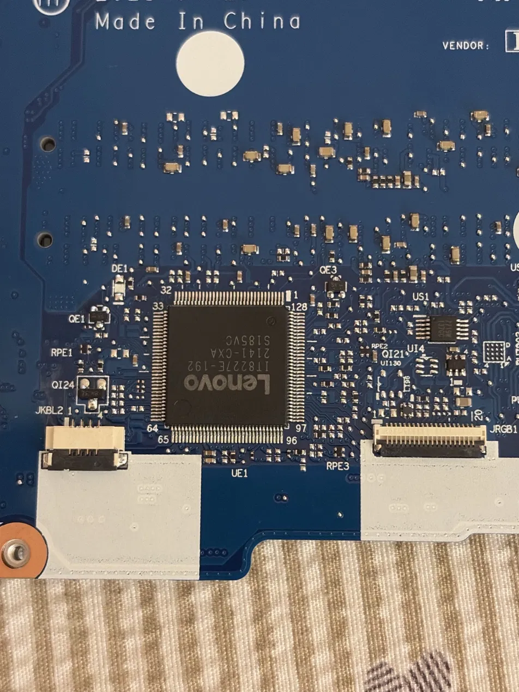
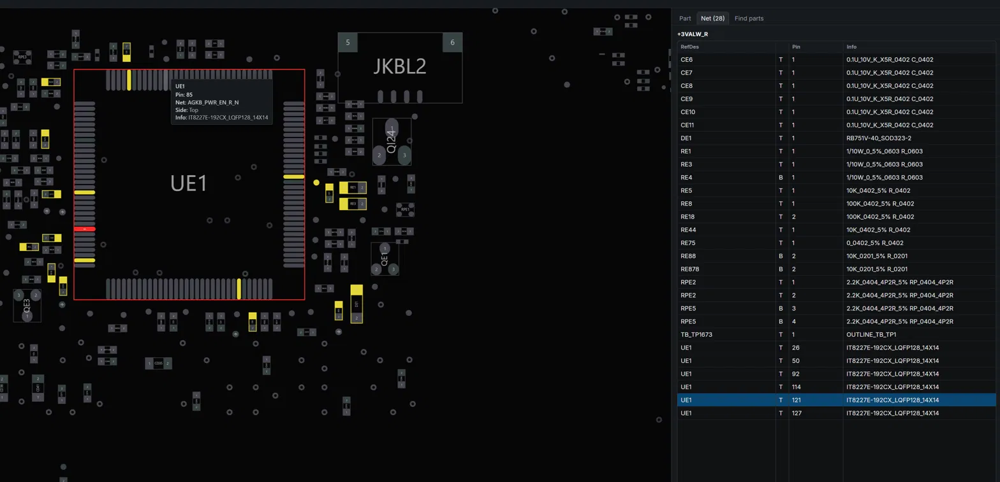
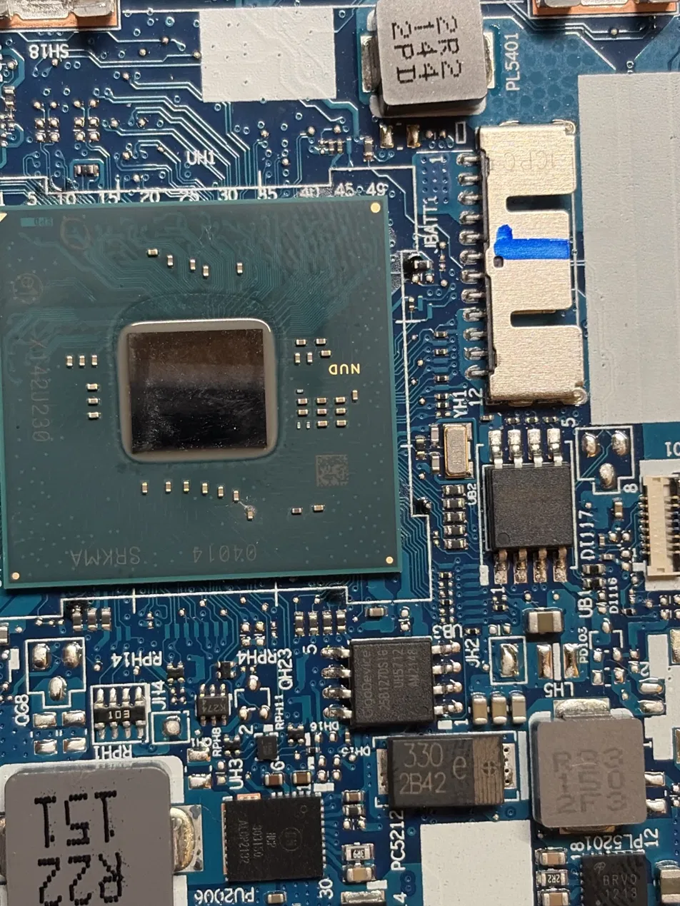
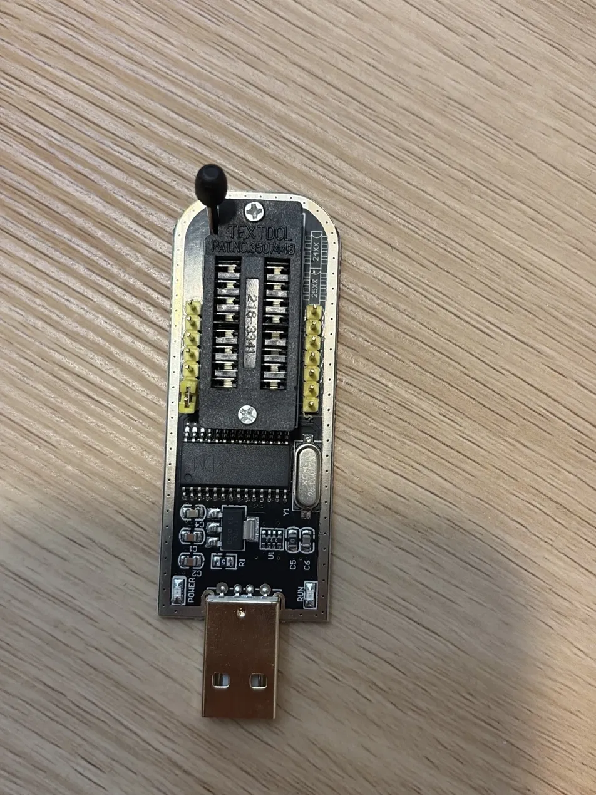
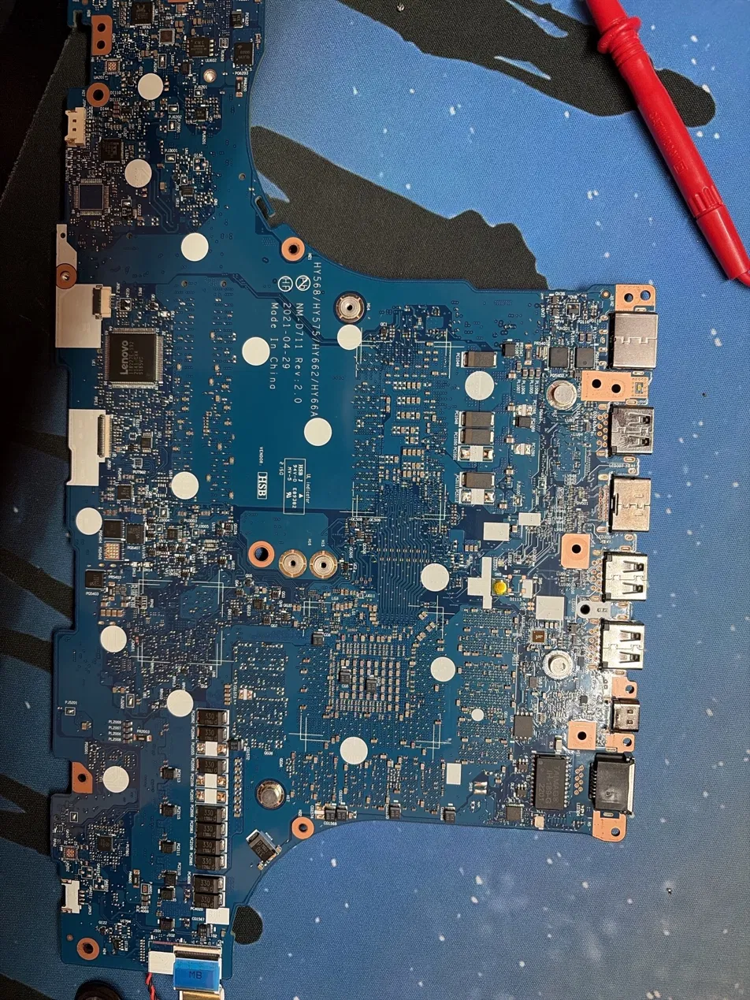
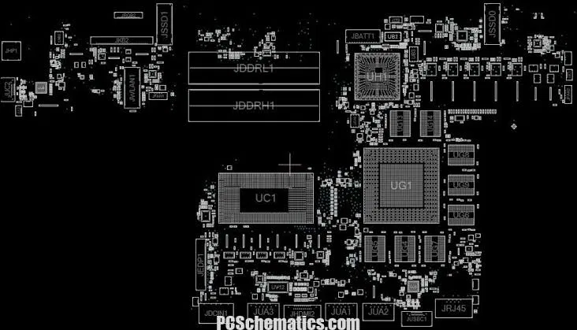

# Reviving a Dead Lenovo Legion 5 15ITH6H with a $10 Programmer

 <em>Status</em>

 <em>Cost</em>

 <em>Tools</em>

**Board:** Lenovo NM-D711 Rev 2.0 (Intel Tiger Lake-H, NVIDIA RTX GPU)
**Embedded controller (EC):** ITE IT8227E-192CX (UE1)
**BIOS flash:** GigaDevice GD25B127D, 16 MB, 3.3 V (UB3)
**Result:** Laptop boots again. Total cost of the repair: about $10.

---

## The story

I damaged my laptop when I spilled a drink on it, and it sat dead for a long time. Eventually I thought: why not repair it? I'm a computer engineering student, after all.

I started by opening the laptop and inspecting **both sides of the motherboard** for burn marks or anything that looked like it was caused by a short. Nothing obvious stood out.

Then I watched about **3 hours of basic computer/laptop repair videos from Electronic Repair School**, which were very informational. The catch: I didn't have the tools shown in the videos. All I had was a **multimeter and a cheap (~$20) soldering iron kit**. So the plan was to do as much as possible with just those.

## Hardware symptoms

- Charger LED on
- Power button's white LED lights when pressed
- No fans, no display (internal screen or external HDMI monitor)

Things I tried that changed nothing: new RAM, new SSD, external monitor, new CMOS battery (at first).

## Diagnosis method

With only a multimeter, the approach was to **follow the power from the charger to each major component**, in the same order the laptop powers itself up:

1. Start at the charging port: the **input fuse, the two input MOSFETs, and the first inductor (coil)**.
2. Follow the power to the "always-on" standby rails (+3VALW, +5VALW, +1.8VALW).
3. Follow the main rails out to the **CPU, GPU, RAM, SSD and the EC chip**.

At each stage I used DC voltage, continuity (beep) and diode mode to check for shorts, missing rails or wrong voltages.

### What I measured

| Check | Result |
|---|---|
| Charger, DC input path, fuse, input MOSFETs | OK |
| Shorts on CPU, GPU, main rails | None found |
| Standby rails (+3VALW, +5VALW, +1.8VALW) | Present and normal |
| EC (UE1) power | OK |
| BIOS flash (UB3) supply pin | 3.3 V |
| GPU rail | **No power** |

### The first lead (a wrong guess, but a useful one)

I had proper voltage at the CPU, the EC chip, and the 3.3 V and 5 V rails, but **no power at the GPU**. I assumed that was why there was no picture.

I talked it over with Claude, which pointed out that the GPU rail being off is not necessarily the fault. The EC and PCH decide *when* to turn those rails on. If the CPU/PCH side has power but the **GigaDevice BIOS chip is corrupted**, the system never gets the instructions it needs to continue the boot sequence, so the GPU never gets enabled.

### The CMOS detour

While checking the always-on line, I did **not** get the 3.3 V I expected, because my CMOS battery was dead. I bought a new CMOS battery. After replacing it the always-on 3.3 V rail was up and the EC-to-PCH `RSMRST` signal went high, which was good news, but there was **still no video**. The power button worked and that was it.

That narrowed the problem to firmware: the BIOS chip was the most likely culprit.

## The hardest part: figuring out which part is which

The most difficult part of the diagnosis was working out **which capacitor/resistor belongs to which signal or component**. Usually a small part belongs to the nearest big chip, but that did not work for the EC chip: it has 128 pins and a crowd of passives around it.

The proper tool for this is a **boardview file**. I could not find one for my exact board (NM-D711), but I found one for a **very similar sibling model (NM-D712)**. Its layout was basically the same but the **net and component names did not match** my board.

My workflow:

1. Find the part's position in the boardview (I used the NexusBV web viewer).
2. Match it to my real board by **silkscreen labels and physical location**.
3. Use Claude to help work out which component on my board corresponded to the net I was looking at.
4. Annotate my own board photos with test points.

### Boardview of the EC (UE1)

The boardview showing the net `+3VALW_R` and its connections to the EC:

 <em>Boardview of EC UE1 showing the +3VALW_R net</em>

### The EC chip on my actual board

 <em>EC chip IT8227E-192CX (UE1) on the board</em>

### Full board and boardview layout

 <em>Full NM-D711 motherboard</em>

 <em>Boardview layout of the sibling NM-D712 board</em>

## Finding the BIOS chip

I located the BIOS flash chip **UB3 (GigaDevice GD25B127D, 16 MB)** next to the CPU/PCH area. There is also a second flash chip, **UB1 (W25R64JV, 8 MB, with RPMC)**, which I deliberately left alone.

 <em>BIOS flash chip GD25B127D (UB3) and the PCH</em>

## The plan: re-program the BIOS chip

I bought a cheap **CH341A USB programmer (about $10)** with a SOIC8 clip.

### The problem: it outputs 5 V

My programmer's **default logic level is 5 V**, but the GD25B127D is a **3.3 V part**. Clipping a 5 V programmer on it risks killing the chip (and possibly the board). I measured 5 V on the clip's pin 1 to confirm.

 <em>CH341A programmer</em>

### The fix: a 3.3 V mod

The CH341A's main chip has two pins that matter here:

- **Pin 28 (VCC)** is the chip's supply and is wired to 5 V on the board.
- **Pin 9 (V3)** is the 3.3 V reference pin.

What I did:

1. **Lifted pin 28** off its 5 V pad and verified with the meter that it no longer connected to the 5 V header.
2. **Soldered pin 28 to the on-board 3.3 V regulator's tab** (the "1117C 33" regulator).
3. **Wired pin 9** to the same 3.3 V point.

Soldering these pins was **hard**: the pins are tiny and I only had a cheap $20 iron kit and **no flux**.

### Verifying the mod before using it

With nothing plugged in, I checked with the multimeter:

- [x] Pin 28 to the 3.3 V tab: beeps (connected)
- [x] Pin 28 to the 5 V header: no beep
- [x] Pin 28 to pin 27: no beep
- [x] Pin 9 to pins 8 and 10: no beep

Then I plugged the programmer into a different computer (USB 2.0, clip not attached to anything) and measured pin 28 (about 3.3 V) and **every clip lead**: all had to be 3.3 V or lower. Any 5 V reading would mean stop.

## Flashing

Safety rules I followed:

- Clip on only when the laptop is **fully unpowered** (charger out, battery disconnected)
- Work only on **UB3**; leave UB1 alone
- Read the chip **twice** and compare the files to make sure the clip connection is reliable
- Compare against the **official 16 MB BIOS image** for this model

After reading the chip and re-programming it with the official BIOS image, I put everything back together, turned on the laptop, and **it started working**.

## Result

The laptop boots again. Total cost: **about $10** for the programmer. The project took **about a week**.

## What I learned

- **Dead does not always mean hardware dead.** A corrupted BIOS/firmware chip can look exactly like a power fault, including a missing GPU rail.
- Power-up is a **sequence**: standby rails, then EC, then `RSMRST` to the PCH, then main rails. Tracing it stage by stage with a multimeter finds where it stops.
- **Logic levels matter.** A 5 V programmer on a 3.3 V chip can destroy it, so I measured before connecting anything.
- A boardview for a **sibling model** is still useful, but you have to verify every net against your real board.
- Good tools (flux, a better iron) make fine-pitch soldering much easier. I managed without, but it was painful.

## Skills demonstrated

Multimeter troubleshooting, power-up sequence analysis, boardview reading, fine-pitch soldering and rework, SPI flash reading and programming, logic-level analysis, documentation, Git/GitHub.

## Tools used

| Tool | Cost |
|---|---|
| Multimeter | already owned |
| Soldering iron kit | ~$20 |
| CH341A programmer + SOIC8 clip | ~$10 |
| New CMOS battery | ~$3 |
| NexusBV web viewer (boardview) | free |

## Disclaimer

This documents what worked for my board. Opening a laptop, soldering on a programmer, and flashing a BIOS can permanently damage hardware. I am not responsible for damage if you try this. Official BIOS images and boardview files belong to their respective owners and are **not** included in this repo.

## Credits

- Electronic Repair School (YouTube) for the basic repair training
- Claude (Anthropic) for helping reason through the power sequence and map boardview nets to my board
- Boardview image from PCSchematics.com (sibling board NM-D712)
